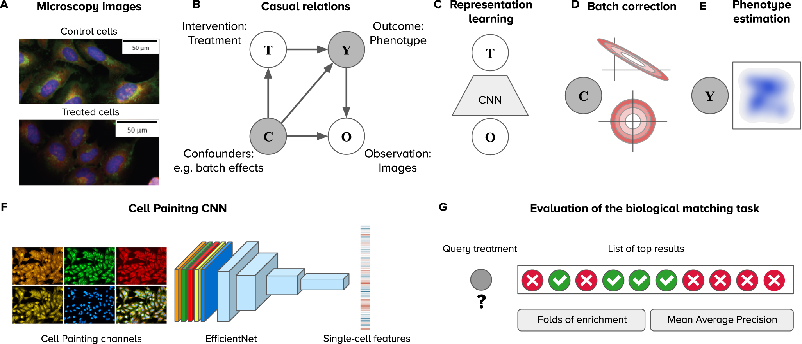
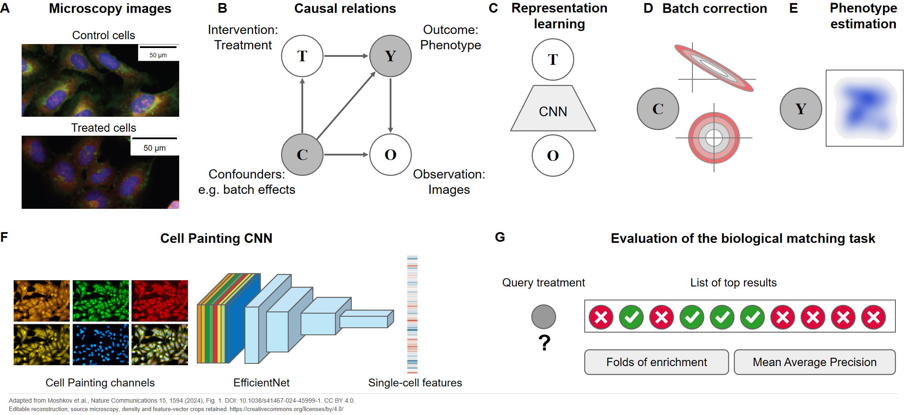
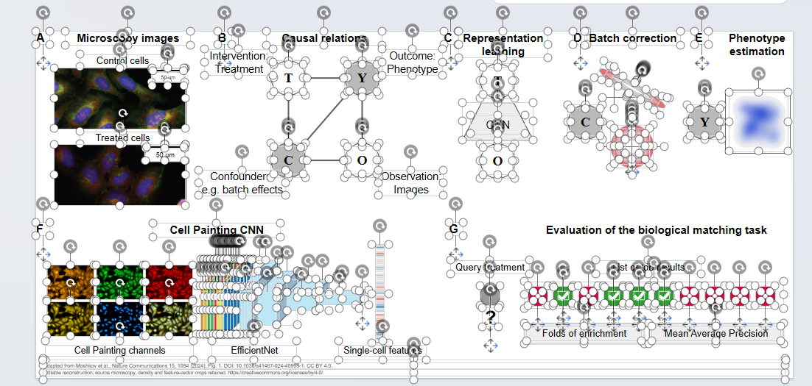

# Nature Communications Figure 1：图片转可编辑 PPT

## 输入与结果

| 文件 | 内容 |
| --- | --- |
| [input.png](input.png) | 出版社完整原图，2053 × 884 像素，包含 A–G 七个面板 |
| [output.pptx](output.pptx) | 一页可编辑重建，保留全部面板，底部增加来源与改编说明 |
| [preview.png](preview.png) | 最终 PPT 在本机 WPS 中实际导出的预览，2053 × 942 像素 |
| [editing-screenshot.png](editing-screenshot.png) | 用户提供的编辑状态截图，展示多个独立对象的选择框、控制点和旋转手柄 |
| [editability.json](editability.json) | 仓库检查脚本对最终 PPTX 的只读对象统计 |

**原图：**



**重建结果：**



**编辑状态（用户提供的截图）：**



可见各对象的选择框、控制点与旋转手柄。这张截图用于展示对象选中状态；图片内部像素的可编辑限制仍按下方说明。

## 可编辑范围

| 内容 | 重建方式 |
| --- | --- |
| 面板字母、标题、变量和外部标签 | 原生文本框，可修改文字、字体和位置 |
| 因果关系节点、箭头、CNN 模块 | 原生形状、路径和线条，可独立选择与调整 |
| 批次校正轮廓、匹配圆点和勾叉 | 原生形状与路径；轮廓仅为原图的定性示意 |
| 两张显微图、六张通道图 | 原图裁片，共八个独立图片对象，可替换；内部比例尺等仍为像素 |
| 表型密度场、单细胞特征向量 | 两个独立原图裁片；缺少原始数值，未按图猜测数据 |

共 **149 个对象**：41 个非空文本框、74 个其他原生形状、24 条原生连线、10 张图片。检查脚本中的 `native_shape_objects = 115` 已包含 41 个文本框，不能重复相加。没有整页截图背景，也没有链接到本机的外部图片。

箭头为独立原生对象；未验证移动节点时端点自动跟随。对象数量不等于可编辑比例，科学图像中的像素内容不能逐元素编辑。

## 可复用提示词

先将 `input.png` 上传到支持该技能的 Codex 环境，再输入：

```text
$image-to-editable-ppt 将这张论文图完整重建为一页可编辑 PPT，保留 A–G 所有面板、原图布局和箭头关系。文字、变量节点、CNN 结构、定性轮廓和匹配符号使用原生对象。显微图、连续密度图和特征向量保留原图，作为独立可替换图片，不推测原始数据。底部注明论文来源、CC BY 4.0 及改编范围，附上实际渲染预览。
```

检查对象：

```bash
python scripts/inspect_editability.py examples/nature-cell-painting/output.pptx
```

## 来源、许可与改编说明

- 论文：Moshkov, N., Bornholdt, M., Benoit, S. et al. **Learning representations for image-based profiling of perturbations.** *Nature Communications* **15**, 1594 (2024)。
- DOI：[10.1038/s41467-024-45999-1](https://doi.org/10.1038/s41467-024-45999-1)。
- 图题：Figure 1, **Framework for analyzing image-based profiling experiments**。
- [出版社原始 PNG](https://media.springernature.com/full/springer-static/image/art%3A10.1038%2Fs41467-024-45999-1/MediaObjects/41467_2024_45999_Fig1_HTML.png)。
- 原图及该改编版本按 [Creative Commons Attribution 4.0 International](https://creativecommons.org/licenses/by/4.0/) 提供；复用时保留作者、来源、许可链接与改编说明。论文图片的许可与仓库代码许可分开。
- 修改：重新绘制文字、节点、箭头、定性轮廓、CNN 模块和匹配符号；从原图保留十个图像裁片；新增来源页脚。字体、线宽和示意几何与原图存在细节差异。
- 本案例展示图形重建能力；没有重新运行论文算法、复现实验或生成预测数据。

最终文件已在本机 WPS 中打开，读取原生标题并导出预览，与原图逐面板对照。未验证所有 PowerPoint/Office 版本，未验证各科学示意背后的原始数据。
